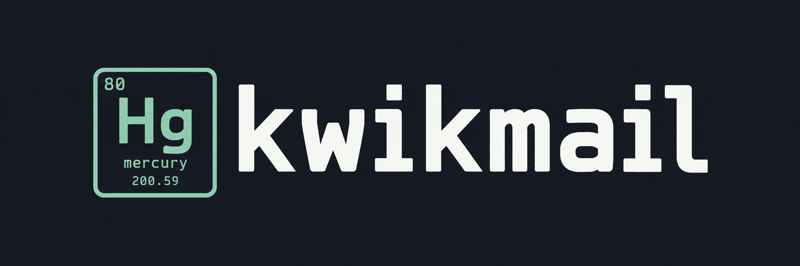
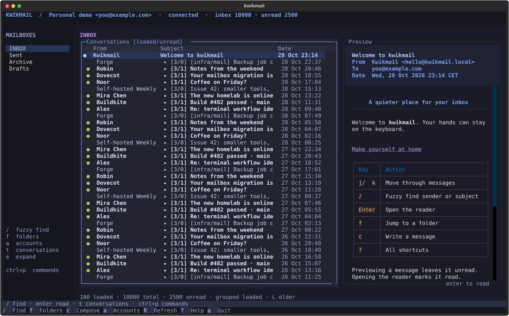
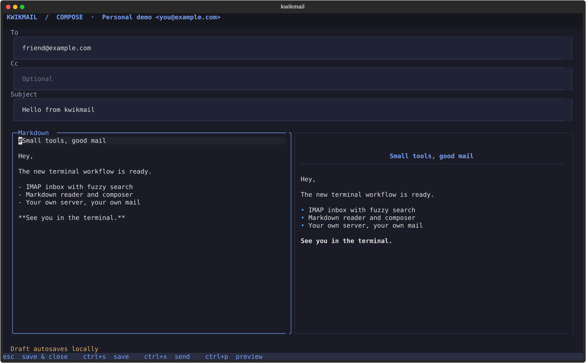

<p align="center">
  
</p>

<p align="center">A small email client for the terminal.</p>

<p align="center">
  <a href="#install">Install</a> ·
  <a href="docs/configuration.md">Configuration</a> ·
  <a href="docs/usage.md">Keybindings</a>
</p>



Read, reply, and send mail from your terminal, locally or over SSH.

- Browse folders and conversations with Vim keys and fuzzy search.
- Write Markdown with a live preview.
- Switch accounts without mixing drafts.
- Download attachments and export invoice candidates with [JSON CLI commands](docs/cli.md).
- Connect directly to your IMAP and SMTP server over TLS.

## Install

[uv](https://docs.astral.sh/uv/) and Python 3.11+ required.

```sh
uv tool install git+https://github.com/a-wiseguy/kwikmail.git
kwikmail --demo
```

Try the demo without an account. To use your mailbox, [add your settings](docs/configuration.md) and run `kwikmail`.

## Compose



Press `c` to compose, `Ctrl+P` to preview, and `Ctrl+X` to review and send. Drafts save as you type.

## Scope

Password, app-password and Gmail/Microsoft OAuth authentication. [Provider setup](docs/providers.md). Manual refresh. Attachment downloads and date-range exports are supported. No outgoing attachments, offline mailbox, or delete/move yet.

[Contributing](CONTRIBUTING.md) · [MIT license](LICENSE) · Built with [Textual](https://github.com/Textualize/textual)
