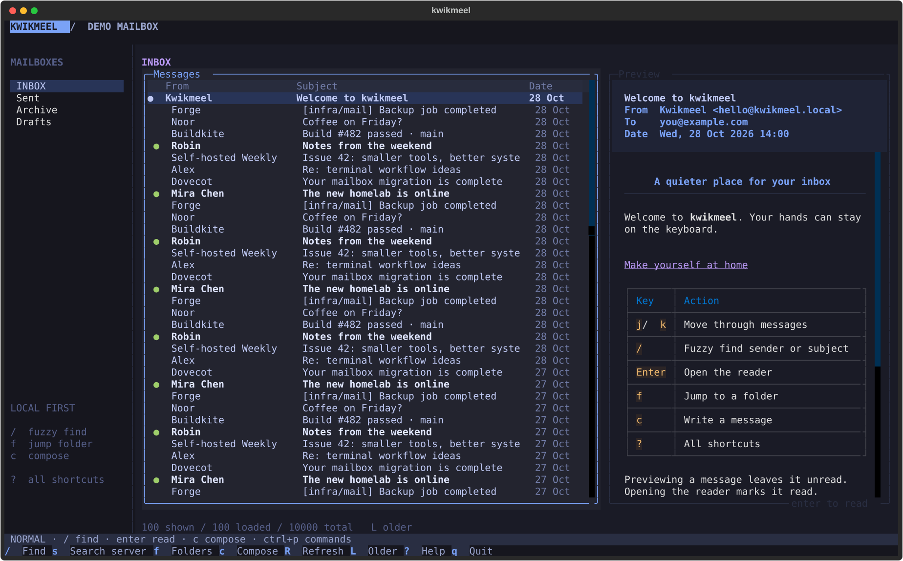

# kwikmeel

A Python terminal mail client for a self-hosted IMAP server. Split panes, Vim-style
navigation, fuzzy finders, and a Markdown composer. The default colors take cues
from Tokyo Night. No Nerd Font required.



## Try it

Requires Python 3.11+ and [uv](https://docs.astral.sh/uv/).

```sh
uv sync
uv run kwikmeel --demo
```

The demo has a sample mailbox and exercises the same UI. Sending in demo mode
never contacts a server. Press `?` for the keyboard reference.

To install the command independently of this checkout:

```sh
uv tool install .
kwikmeel --demo
```

## Connect to docker-mailserver

Use the server's externally reachable mail hostname, matching its TLS certificate.
The default configuration uses IMAPS on port 993 and SMTP submission with STARTTLS
on port 587. Both authenticate with your full email address and mailbox password.
SMTP over implicit TLS on port 465 also works with `smtp_security = "tls"`.

```sh
mkdir -p ~/.config/kwikmeel
cp config.example.toml ~/.config/kwikmeel/config.toml
chmod 600 ~/.config/kwikmeel/config.toml
${EDITOR:-vi} ~/.config/kwikmeel/config.toml
```

Set `host`, `username`, `address`, and `name`. Check that `sent_folder` matches a
folder on your server. `kwikmeel --check` lists selectable folders. Set
`sent_folder = ""` if your server already files outgoing mail automatically.
Kwikmeel does not create remote folders.

Supply the password through a password manager command or environment variable.
For example, macOS Keychain can be used with the following config entry after
you create a generic password named `kwikmeel` in Keychain Access:

```toml
password_command = ["security", "find-generic-password", "-s", "kwikmeel", "-w"]
```

For a temporary interactive session, this Bash/Zsh-compatible prompt avoids
placing the password in shell history:

```sh
printf 'Mailbox password: '
read -rs KWIKMEEL_PASSWORD
printf '\n'
export KWIKMEEL_PASSWORD
uv run kwikmeel --check
uv run kwikmeel
unset KWIKMEEL_PASSWORD
```

`password_command` is an array of executable arguments, run without a shell. Its
stdout must contain only the password. `password_env` takes precedence when set.
For different SMTP credentials, set `smtp_username` and `smtp_password_env`.
For a private certificate authority, set `ca_file` to its PEM bundle; certificate
and hostname verification remain enabled.

Use `--config /path/to/account.toml` for an alternate account. Configuration follows
`XDG_CONFIG_HOME` if set. The app never stores a password in its draft file.

## Keys

| Key | Action |
| --- | --- |
| `j` / `k`, arrows | Next / previous message |
| `g` / `G` | First / last loaded message |
| `Ctrl+D` / `Ctrl+U` | Page down / up |
| `/` | Fuzzy filter loaded senders and subjects |
| `s` | Search the entire selected folder, including body text |
| `Enter` | Open the reader and mark the message read |
| `Esc` | Leave the reader, or clear the current search |
| `f` | Fuzzy folder picker |
| `c` | Compose or resume a saved draft |
| `R` | Reconnect and refresh |
| `L` | Load the next batch of older messages |
| `Tab` / `Shift+Tab` | Move between panes |
| `Space` / `Ctrl+P` | Command picker |
| `?` | Help |
| `q` / `Ctrl+Q` | Quit |

In pickers, type to filter, `Ctrl+J/K` or arrows to select, and `Enter` to accept.
In the reader, `j/k` scroll and `q` or `Esc` returns to the mailbox.

Local fuzzy filtering searches only loaded headers and displays up to 500 ranked
matches. Server search uses IMAP's substring matching, runs on Enter, and includes
the selected folder's entire contents. Press `Esc` to return to the unfiltered folder.

## Compose and send

`c` opens the saved draft, or a blank one. `Tab` moves between To, Cc, Subject and
the Markdown body. `Ctrl+S` saves immediately; `Esc` saves and closes. `Ctrl+P`
toggles the rendered preview. Drafts autosave 600 ms after typing stops.

`Ctrl+Enter` opens a recipient confirmation. `Ctrl+X` does the same in terminals
that cannot distinguish Ctrl+Enter from Enter. Press `y` to send, or `Esc` to edit.
Outgoing mail includes a plain-text Markdown part and rendered HTML alternative.

SMTP acceptance clears the draft. The app then appends a copy to `sent_folder`.
If saving that copy fails, the app reports it and prevents resending that message.
Partial recipient rejection is reported separately. If a connection drops during
sending, the draft is retained and the app asks you to check delivery before retrying.
No automatic send retries occur.

One draft per account is stored under
`~/.local/state/kwikmeel/<account-id>/draft.json`, or `XDG_STATE_HOME`. Drafts are
plain text with owner-only permissions and atomic writes. They are not synchronized
to the IMAP Drafts folder. The demo uses a separate draft. Body and header caches
are kept in memory only.

## Performance and scope

The UI never waits synchronously for IMAP or SMTP. One dedicated thread owns the
IMAP connection; SMTP uses a separate connection. Normal folder loads fetch only
the latest 100 headers using a sequence range, without listing every UID or
downloading bodies. `page_size` can be set from 10 to 500.

Preview requests are debounced by 120 ms. Canceled queued requests are skipped,
and late responses cannot overwrite the latest selection. The last 24 parsed
bodies are cached by folder, UIDVALIDITY, and UID. Reopening a cached preview needs
no network request. Preview fetches use `BODY.PEEK`, leaving unread state intact.

Bodies are capped at 2 MB of wire data and 80,000 displayed characters. Large
messages show a truncation notice. HTML-only mail is converted to Markdown. Remote
images and active HTML are stripped. Links do not launch automatically. Attachments
are listed when MIME information is available but cannot be opened or added in v1.

The sidebar disappears below 110 columns; below 85 columns the message list fills
the screen and Enter opens the reader. A terminal of at least 80 × 30 is recommended.

V1 is one account per process. It has no IMAP IDLE/push, automatic polling, offline
mail store, reply/threading, delete/move, attachment transfer, or OAuth. Use `R` for
new mail. Paging uses sequence positions; concurrent expunges can change those
positions, so refresh if another client removes messages while paging. Server-wide
search collects matching UIDs and can take longer on a large mailbox.

## Development and verification

```sh
uv run pytest -q
uv run ruff check src tests scripts
uv run ruff format --check src tests scripts
uv run python scripts/verify.py
uv build
```

Tests drive the actual Textual app with keypresses and use local TLS socket servers
for IMAP and SMTP. They cover MIME parsing, search, pagination, unread flags, draft
recovery, failed sends, certificate validation, and partial recipient rejection.
They do not send external email. The verification script exports demo screenshots
and reports local fuzzy-search and render timings. These are local measurements,
not a guarantee about server latency.

See [the architecture notes](docs/architecture.md) for ownership and tradeoffs.
